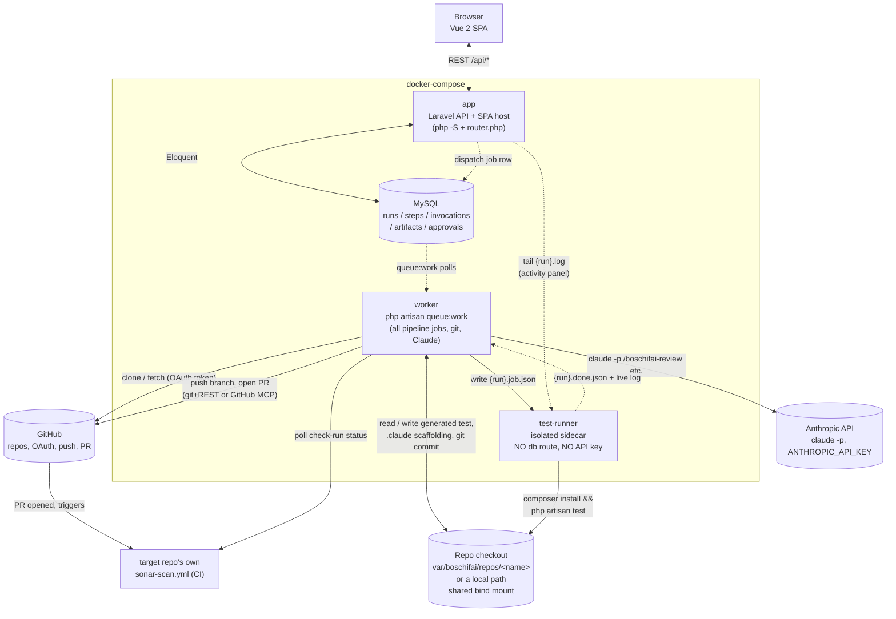

# Boschifai

Boschifai takes a plain-text requirement (or a "just improve coverage" instruction, or a
one-shot documentation request), runs it through AI-assisted analysis, and — after a human
approves — generates a test plan, test cases, and PHPUnit Feature test code, runs it for real
against the target repo, and (after a second human approval) opens a real GitHub pull request
and reports back a composite confidence score once CI concludes.

A visual overview of the solution, its architecture and technology stack lives in
[`docs/overview.html`](docs/overview.html) — open it directly in a browser.

**Scope today:** requirement runs generate PHPUnit Feature tests against a human-specified
target file; coverage runs pick their own target file and generate tests in whatever framework
the target repo already uses (see `PromptBuilder` and `GitStatusDiffCollector::classify()`). Target repos are connected via
"Connect Repo" (`resources/js/pages/GithubSettingsPage.vue`) — either a GitHub account's repos
(OAuth), or a repo already checked out on disk. Each connected repo gets exactly ONE persistent
checkout that every Run against it shares and works on directly (see
`app/Services/Sandbox/RepoCheckoutManager.php`): a GitHub-connected repo is cloned into
`var/boschifai/repos/<name>` and kept in sync per run; a local repo is used at its own path and
is never cloned, reset, or otherwise force-modified. Because the checkout is shared, only one Run
per repo may be in flight at a time (`RunController::store()` rejects a second one with a 422).

## Technology stack

| Layer | Technology |
| --- | --- |
| Backend | Laravel 12 (PHP 8.2+; the Docker image runs PHP 8.3), Guzzle, `symfony/process` |
| Frontend | Vue 2.7 SPA, Vue Router 3, Vuex 3, Vite 6, TailwindCSS 3 (+ typography), `marked` + DOMPurify for Markdown artifacts |
| Database / queue | MySQL 8 in Docker, SQLite bare-host; Laravel `database` queue driver |
| AI engine | Claude Code CLI run headless (`claude -p`), model `BOSCHIFAI_CLAUDE_MODEL` (default `claude-sonnet-5`) |
| Scaffolding CLI | `boschifai`: Rust workspace (`boschifai-cli`, `boschifai-core`, `boschifai-ai`) vendored at `docker/boschifai-cli/`. `boschifai init` installs 15 `.claude/commands`, 29 `.claude/skills` and 16 Copilot `.github/prompts` templates |
| GitHub | OAuth App (`repo` scope), REST API for PRs and check runs, optional `github-mcp-server` push path |
| Test execution | Isolated `test-runner` sidecar (PHP 8.3 + Composer + Node 20 + pcov), JUnit XML parsing |
| Runtime | Docker Compose: `app`, `worker`, `test-runner`, `db` |
| Tests | PHPUnit 11, Mockery, in-memory SQLite (`tests/Unit`, `tests/Feature`) |

## Architecture



- **`app`** — serves the Vue SPA and the JSON API. Never runs a pipeline job and never touches a
  repo checkout directly.
- **`worker`** — the only service that runs pipeline jobs: prepares the repo checkout, drives
  headless Claude Code, commits/pushes, polls CI. Carries Boschifai's own DB credentials as
  ambient environment, which is exactly why it must never run a *connected repo's* test command
  itself (see `test-runner` below).
- **`test-runner`** — a deliberately credential-less sidecar that runs a connected repo's own
  `composer install` + `php artisan test`. Split out from `worker` after a real incident: a
  connected repo's test suite inherited `worker`'s live DB env vars and its `RefreshDatabase`
  trait ran `migrate:fresh` against Boschifai's *own* database. `test-runner` has no `DB_*`/
  `ANTHROPIC_API_KEY` vars, no `.env`, and sits on its own Docker network with no route to `db` —
  not just "doesn't use" those credentials, structurally *can't* reach them. `worker` and
  `test-runner` talk over a shared volume via a tiny job-file protocol (`{run}.job.json` →
  `{run}.done.json`), not a socket or HTTP call — see `docker/test-runner/poll.php`'s docblock
  for the full protocol.
- **Repo checkout** — one persistent working copy per `RepoConfig`, shared by every Run against
  it (see `RepoCheckoutManager`). GitHub-connected: cloned/fetched with a per-connection OAuth
  token that's never written to disk. Local: the user's own path, mounted read-write into
  `worker`/`test-runner` and read-only into `app` (for browsing).

## How a pipeline run flows

See `app/Enums/RunState.php` for the authoritative state machine. The two human approval gates
(after gap analysis, after local execution) are the only manual steps — everything else is a
queued job (`app/Jobs/*.php`) chained automatically:

1. **Gap analysis** (`/boschifai-review`) — testability score + gaps.
2. **Test plan** (`/boschifai-test-plan`) — or, in coverage mode, test *design* plus a
   `RECOMMENDED_TARGET_FILE:` the pipeline extracts for itself, since coverage mode has no
   human-specified target file.
   → **Gate 1** (human approves/rejects the combined review + plan).
3. **Test case generation** (`/boschifai-test-cases`) — includes its own Task-tool validator;
   `NEEDS_FIXES` triggers up to `boschifai.claude.max_retries.test_case_generation` automatic
   re-attempts before blocking for a human.
4. **Code generation** (`/boschifai-gen-component`) — the actual PHPUnit Feature test file,
   written straight into the shared checkout.
5. **Local execution** — the generated test runs for real, via `test-runner` (see above). Failing
   tests can trigger **Fix failing tests**, which asks Claude to edit the file in place and
   re-runs this step.
   → **Gate 2** (human approves/rejects the generated code + real local pass/fail).
6. **Push** — branch + commit (exact-file-only, hard-asserted — never `git add -A`) + PR, either
   a fully deterministic git/REST flow or, if `GITHUB_MCP_PAT` is configured, a constrained
   Claude+GitHub-MCP invocation with the local commit already prepared and verified beforehand.
7. **CI polling** — watches the target repo's own existing `sonar-scan.yml` check run (no
   workflow files are touched) and computes the composite **confidence score**
   (`ConfidenceScoreCalculator`, weights in `config/boschifai.php`) from testability, test-case
   quality, local execution, and CI.

### Confidence score

`ConfidenceScoreCalculator` combines four 0–100 signals using weights from
`config/boschifai.php` (`confidence_weights`). The weights are a starting proposal, not a
validated formula:

| Signal | Weight | Source |
| --- | --- | --- |
| Testability | 25 | `/boschifai-review`'s testability score |
| Test-case quality | 20 | Validator verdict: `APPROVED` = 100, `NEEDS_FIXES` = 40, verdict not found = 80 |
| Local execution | 25 | Pass rate from the `test-runner` JUnit results |
| CI | 30 | Check-run conclusion: `success` = 100, anything else = 0 |

At Gate 2, CI hasn't run yet, so `calculatePrePush()` leaves CI out and rescales the other
three weights to sum to 100. That keeps the Gate 2 score from being dragged down by a missing
CI result.

Two run types skip most of this entirely — **Standalone Actions** (`build_skills` /
`build_knowledge_base`, `RunStandaloneActionJob`) are a single Claude invocation that reads the
connected repo and writes one artifact, with no approval gate and no push at all.

## Connecting a repository

Two ways, both under "Connect Repo":

- **GitHub OAuth** — a classic OAuth App (`repo` scope, the same mechanism as VS Code's "Sign in
  with GitHub"), not a GitHub App installation. There's no native GitHub repo-picker for this
  flow; repo selection happens entirely in Boschifai's own UI after authorizing
  (`GithubConnectionController`). An organization can be excluded from the picker entirely
  (`ExcludedGithubOrganization`) and restored later.
- **Local repo** — browse and connect a repo already checked out on disk
  (`LocalRepoController`), confined to a single configured root
  (`BOSCHIFAI_LOCAL_REPOS_ROOT_PATH`) and resolved with `realpath()` so a browse request can't
  escape it — this app has no authentication layer at all, so that boundary matters.

Either way, `RepoConfig.copy_untracked_files` can list gitignored files (a private Composer
`auth.json`, etc.) to copy from the connected repo into the checkout, since git-tracked-only
checkouts and `.claude/` scaffolding regeneration (`boschifai init`) can't see them.

## Prerequisites

Two ways to run this: bare-host (needs everything below installed locally) or
[Docker](#running-with-docker) (needs only Docker — the `boschifai` CLI it depends on is vendored
into this repo at `docker/boschifai-cli/` and built as part of the image).

- PHP 8.2+, Composer
- Node.js + npm
- Git
- The `claude` CLI, installed and logged in (used non-interactively — no `ANTHROPIC_API_KEY`
  is required locally if `claude` already has its own stored credentials; production should
  source one via AWS SSM per `config/boschifai.php`'s TODO comments)
- The `boschifai` CLI, built from the source vendored at `docker/boschifai-cli/` (`cargo build
  --release --package boschifai-cli` from that directory) and on your `PATH` — `boschifai init`
  is what materializes `.claude/commands`/`.claude/skills` into the checkout; it's required even
  though `boschifai` itself doesn't do the generation. Docker mode builds this for you
  automatically; bare-host mode does not.
- A registered GitHub OAuth App (`BOSCHIFAI_GITHUB_OAUTH_CLIENT_ID`/`_SECRET`, see
  `.env.example`) — only needed for the GitHub-connected half of "Connect Repo"; connecting a
  repo already checked out on disk needs no OAuth App at all
- Whatever a connected repo's own test suite needs at runtime (its own `composer install` +
  `php artisan test` — see `LocalTestRunner`)

## Setup

```bash
composer install
npm install
cp .env.example .env
php artisan key:generate

# Set BOSCHIFAI_GITHUB_OAUTH_CLIENT_ID / _SECRET (see .env.example) before you'll be able to
# connect a real GitHub account and select repos from the UI.

php artisan migrate          # creates the sqlite DB — no seeding needed, repos come from Connect Repo
npm run build                # or `npm run dev` for a live-reloading Vite dev server

php artisan boschifai:create-user you@example.com   # asks for a password; then sign in at /login
```

## Signing in and workspaces

Every page and API route requires a signed-in user (Laravel Fortify for login/logout/password
reset, Sanctum cookie sessions for the Vue app) who belongs to a **workspace**. A workspace is one
customer's separate space — its own repositories, GitHub connections, runs and token usage; nothing
is visible across workspaces (another workspace's run, repository or connection is simply a 404).
Users can belong to several workspaces and switch between them from the header.

Roles per workspace:

| | Member | Admin | Owner |
|---|---|---|---|
| Submit, review, approve, retry, cancel, archive runs | ✓ | ✓ | ✓ |
| Connect/remove repositories and GitHub accounts, delete runs | | ✓ | ✓ |
| Invite people, change roles, remove members, rename the workspace | | ✓ | ✓ |
| Grant, change or remove the **owner** role | | | ✓ |

A workspace always keeps at least one owner: the last owner can't be demoted or removed until
someone else is made an owner. Every membership change (invited, revoked, joined, role changed,
removed, renamed) is written to the append-only `audit_events` table.

### Inviting people

Admins and owners manage the workspace under **Settings → Workspace**: invite by email with a role,
change roles, remove members and revoke pending invitations. The invitation email goes through the
same mail settings as password resets — see [Sending email](#sending-email-amazon-ses). Its link opens `/invitations/{token}`:

- someone **new** chooses a name and password there and is signed straight in (the address is
  treated as verified — they received the email);
- someone who **already has an account** signs in first and then joins with one click — an
  invitation never sets or changes an existing account's password;
- the link only works for the invited address, expires after **7 days**, works **once**, and
  re-inviting the same address replaces the earlier link. Only a SHA-256 hash of the token is
  stored, so a database dump can't be used to accept invitations.

There's no open sign-up page: until billing exists, people join a workspace by invitation, and the
very first user (or a brand-new workspace) is created from the command line:

```bash
php artisan boschifai:create-user someone@example.com --name="Someone" --workspace="Acme Rentals" --role=admin
# Docker: docker compose exec app php artisan boschifai:create-user someone@example.com --workspace="Acme Rentals"
```

`--workspace` (default `Default`) is created if it doesn't exist; `--role` defaults to **owner** of
a new workspace and **member** of an existing one.

The password is typed at a hidden prompt (at least 12 characters, letters and numbers); it is never
taken as an argument or printed. Users can change it under **Account**, or reset it from
**Forgot your password?** on the login page — the reset email goes through the mail settings
(see [Sending email](#sending-email-amazon-ses)).
The forgot-password form replies the same way whether or not an address has an account, so it
can't be used to discover who has one.

If the app is served from a host or port other than `APP_URL`, add it to `SANCTUM_STATEFUL_DOMAINS`,
otherwise sign-in succeeds but API calls return 401.

### Sending email (Amazon SES)

Invitations and password resets are emailed. With the default `MAIL_MAILER=log` nothing is sent —
each message is written to `storage/logs/laravel.log` (handy locally: the invitation link is in
there). To deliver real email through Amazon SES:

1. **Verify a sending identity in SES** — preferably your domain (publish the DKIM CNAME records
   SES gives you; add SPF/DMARC too), in the region you'll send from. Check SES is offered in your
   preferred region; using one in South Africa avoids sending recipients' addresses abroad (POPIA
   section 72 — confirm with whoever owns compliance if you use a region elsewhere).
2. **Leave the SES sandbox.** A new SES account can only send *to* verified addresses — invitations
   to anyone else fail with "Email address is not verified". Request production access in the SES
   console (Account dashboard), or verify each test recipient while you wait.
3. **Give the app permission to send — and nothing else.** On ECS, attach this to the task role
   and leave the key variables empty; locally, create an IAM user with only this policy and put its
   access key in `SES_ACCESS_KEY_ID` / `SES_SECRET_ACCESS_KEY` (never commit them; in production use
   the role or AWS SSM, not a plain `.env` value):

   ```json
   {
     "Version": "2012-10-17",
     "Statement": [{
       "Effect": "Allow",
       "Action": "ses:SendRawEmail",
       "Resource": "arn:aws:ses:<region>:<account-id>:identity/<your-domain>",
       "Condition": { "StringEquals": { "ses:FromAddress": "<MAIL_FROM_ADDRESS>" } }
     }]
   }
   ```

4. **Configure the app** (`.env`):

   ```dotenv
   MAIL_MAILER=ses
   MAIL_FROM_ADDRESS="no-reply@your-domain"   # on the identity verified in step 1
   MAIL_FROM_NAME="BoschifAI"
   SES_REGION=<region from step 1>
   SES_ACCESS_KEY_ID=          # empty on AWS (task role); set only locally
   SES_SECRET_ACCESS_KEY=
   ```

   `SES_*` fall back to `AWS_ACCESS_KEY_ID`, `AWS_SECRET_ACCESS_KEY` and `AWS_DEFAULT_REGION` when
   unset. None of these variables reach the `claude` process (see [Agent isolation](#agent-isolation)).

5. **Restart and test:**

   ```bash
   docker compose restart app worker
   docker compose exec app php artisan boschifai:send-test-email you@your-domain
   ```

   It prints the mailer, sender and region in use (never the credentials) and, if SES refuses the
   message, SES's own reason.

If an invitation email can't be sent, nothing is saved — the admin sees "We couldn't send the
invitation email" and can try again, and any earlier link for that address keeps working.

## Running the app

```bash
php artisan serve
```

Then open the URL it prints. The Vue app is a single-page app served from one Laravel route
(`routes/web.php`'s catch-all → `resources/views/app.blade.php`); the API lives under `/api/*`
(`routes/api.php`).

### The queue worker

Every pipeline step (gap analysis, test-case generation, code generation, local execution,
push, CI polling) runs as a queued job, so nothing happens until a worker is running:

```bash
php artisan queue:work
```

**Do not run `queue:work` with its default settings and assume it's fine** — Claude-invoking
jobs can take up to ~30 minutes (`config('boschifai.claude.timeouts.*')`), and Laravel's queue
worker kills jobs after 60 seconds by default. Every job that needs longer already overrides
its own `$timeout`/`$tries` properties (see `app/Jobs/*.php`), so a plain `php artisan
queue:work` respects those per-job overrides correctly — just don't override them back down
with a global `--timeout` flag lower than a job's own `$timeout`.

For the same reason, `DB_QUEUE_RETRY_AFTER` (`.env.example`: `3600`) must be longer than the
longest job `$timeout` (currently `RunCodeGenerationJob`, 1900s). If it isn't, the `database`
queue driver treats a still-running job as lost and hands the same run step to another
worker.

For local development, `composer dev` starts the server, a queue listener, `pail` log tailing
and the Vite dev server together.

## Running tests

```bash
php artisan test
```

`phpunit.xml` runs tests against an in-memory sqlite database, isolated from your local dev
database (`database/database.sqlite`) — this was previously misconfigured (commented out, per
Laravel 11's own scaffold default) and would silently wipe real local data every time the test
suite ran. If you ever see your local Runs disappear after running tests, check that
`DB_CONNECTION`/`DB_DATABASE` are still uncommented in `phpunit.xml`.

Unit tests (`tests/Unit/Services`) cover the parsers, `PromptBuilder`, `LocalTestRunner`'s
recipe handling, `RepoCheckoutManager` auth, and GitHub OAuth. Feature tests (`tests/Feature`)
cover every `/api/*` endpoint group, the OAuth controllers and the pipeline jobs.

## Running with Docker

`docker-compose.yml` runs four services: `app`, `worker`, `test-runner`, and `db` (MySQL) — see
[Architecture](#architecture) above for what each one does and why `test-runner` is isolated the
way it is.

```bash
docker compose up -d --build
```

That's it — `app` and `worker` each run their own `php artisan migrate --force` on every
start (idempotent, safe if both race on first boot; `restart: unless-stopped` retries the
rare loser). No seeding: visit `http://localhost:8420`, use "Connect Repo" to authorize a
GitHub account (or browse to a repo already checked out on disk) and pick repos.

The Dockerfile **compiles a Linux `boschifai` from source** as a build stage
(`docker/app/Dockerfile`'s `boschifai-builder` stage, source vendored at `docker/boschifai-cli/`)
— a `boschifai` binary built for your host is not portable into a Linux container, so this
happens automatically on every image build with no path configuration needed.

Set these in `.env` before building (see `.env.example` for the full list with explanations):

- `ANTHROPIC_API_KEY` — required for headless `claude -p` to authenticate inside a container
  (there's no interactive login possible there). Get one from the Claude Console.
- `BOSCHIFAI_GITHUB_OAUTH_CLIENT_ID` / `BOSCHIFAI_GITHUB_OAUTH_CLIENT_SECRET` — identify this
  app's GitHub OAuth App (a one-time, out-of-band registration — see `.env.example`'s comment
  for the exact steps). Without these, connecting via GitHub 422s immediately with a clear
  message — connecting a local repo doesn't need these at all.
- `BOSCHIFAI_LOCAL_REPOS_ROOT` — the host directory "Connect Repo"'s local-filesystem section
  is allowed to browse (bind-mounted into `app` read-only, into `worker`/`test-runner`
  read-write).
- `GITHUB_MCP_PAT` — optional; only needed for the opt-in GitHub-MCP push path (see
  `config/boschifai.php`'s `github_mcp` docblock). Leave blank to keep the default deterministic
  push path.

### `auth.json` and other gitignored files

A private Composer package pulled over SSH and authenticated via a gitignored `auth.json` is a
real, previously-hit failure mode — like `.claude/commands`, such files are invisible to a fresh
GitHub-connected checkout (git only carries tracked files), and `composer install` fails without
them. `RunWorkspaceManager` copies whatever's listed in a `RepoConfig` row's own
`copy_untracked_files` column from `git_remote_path` into the checkout (a no-op for a local repo,
whose checkout already has these files for real). There's no UI for this yet — set it directly on
the row (`php artisan tinker`) if a connected repo needs it.

## Reporting

Under the sidebar's "Reporting" section — all read-only views over existing data, no separate
write path:

- **Confidence Reports** — every run's composite score and its breakdown.
- **Coverage Reports** — generated test files, their local pass/fail, and (where available) an
  HTML coverage report per class.
- **Test History** — every locally-executed test, across every run.
- **Token Usage** — every headless Claude invocation this calendar month, summed and itemized
  (`UsageController`, `claude_invocations` table) — this is the *entire* `ANTHROPIC_API_KEY`
  spend, since that table is written by exactly one code path
  (`StepExecutionService`/`HeadlessClaudeInvoker`) and nothing else ever authenticates against
  that key. Also linked directly from the header badge.

### Credits

Usage is paid for with prepaid credits: **1 credit = US$1**, stored as integer micro-dollars so
nothing is rounded through a float. Every Claude step is priced and recorded in
`invocation_charges`; a pricing error is reported and never stops a pipeline.

- **`BILLING_ENFORCE=false` (default) — shadow mode.** No credits are held or charged and nothing
  is blocked; the charges are only recorded, for calibration.
- **`BILLING_ENFORCE=true`.** Before each Claude step its **hold** is reserved from the
  workspace's credits; when the step ends the charge is taken from the hold and the rest
  returned (a crash returns all of it). A run that can't cover its next step **pauses** in
  *Awaiting credits* instead of failing — add credits, then press **Resume** on the run (or
  cancel it). Starting a run, retrying a step, approving a gate or fixing tests is refused up
  front with HTTP 402 and the amounts when the workspace can't cover that step. Only switch on
  once every step's hold is set and workspaces have credits: a step with no hold still runs,
  uncharged, and is reported as an error so it gets fixed.

How a step is priced (`App\Services\Billing\SettlementPolicy`, figures from `config/billing.php`):

| How the step ended | Charged |
|---|---|
| Finished, or failed on its own work (e.g. ran out of turns) | cost × markup, at least the minimum charge |
| Stopped by the user | what was actually used, at cost |
| The platform's fault: API key rejected, platform out of Anthropic credit, rate limit, overload, server error, timeout, CLI crash | nothing |

The charge never exceeds the step's **hold** (the credits reserved before it runs); anything above
it is absorbed by the platform and shows in the report.

Markup, minimum charge and holds are **business decisions for finance** — they are unset by
default (priced at cost). To calibrate them from real usage:

```bash
php artisan boschifai:billing-report --days=30
# Per step: runs, charged/partial/free, cost avg/p95/max, hold, charged, absorbed — plus totals and margin.
```

A sensible starting point is a hold around each step's p95 cost × markup.

Platform admins can add or remove a workspace's credits (needs a reason, asks for confirmation, is
written to the audit log; credits can't go below zero):

```bash
php artisan boschifai:adjust-credits acme-rentals 25 --reason="Starting credit"
```

The ledger (`credit_ledger_entries`) is append-only, every movement carries an idempotency key (a
repeated job or webhook never moves credits twice), and the cached `workspace_credit_balances`
always equal the ledger's sums.

A hold that was never settled (the worker died mid-step) is returned by:

```bash
php artisan boschifai:release-stale-holds   # only holds older than the longest step timeout + 30 min
```

There's no scheduler yet, so run it from cron (e.g. hourly) once enforcement is on.

#### Buying credits

Owners and admins buy credit packs (`BILLING_PACKS`) through a payment provider. Stripe, Paystack
and PayFast plug in as adapters behind `App\Services\Payments\PaymentProvider`; none is
implemented yet — which goes first is an open decision (see
[docs/outstanding-decisions.md](docs/outstanding-decisions.md)). The provider-independent part is
in place:

- `POST /api/billing/checkout` quotes the pack in the provider's currency (USD, or ZAR at
  `PAYMENTS_FX_ZAR_RATE` plus `PAYMENTS_FX_ZAR_BUFFER`, rounded up to the cent), records a pending
  payment and returns the provider's checkout URL.
- **Credits are granted only by the provider's webhook** (`POST /webhooks/payments/{provider}` —
  outside the web and api groups: no session, CSRF or sign-in). It must carry a valid signature
  (otherwise 400 and an error report); each event is processed once; the payment is then
  **confirmed with the provider directly** and its amount and currency must match the stored
  quote exactly. A mismatch is parked as `needs_review` and reported — never credited. Credits are
  granted once per payment, written to the ledger and the audit log.
- Webhook payloads are stored redacted (no card or buyer details). If confirming with the
  provider fails, the event isn't marked as seen, so the provider's retry processes it.
- `GET /api/billing` returns the balance, packs, providers and recent payments;
  `GET /api/billing/payments/{id}` is what the return page polls.

## API reference

All endpoints are under `/api` (`routes/api.php`). None are authenticated (see
[What's not wired up yet](#whats-not-wired-up-yet)).

| Method | Path | Purpose |
| --- | --- | --- |
| GET / POST | `/runs` | List runs, or create one (requirement, coverage or standalone action, with optional attachments) |
| GET / DELETE | `/runs/{run}` | Show run detail, or delete it |
| GET | `/runs/{run}/activity` | Live activity tail for the run page |
| POST | `/runs/{run}/steps/{step}/retry` | Retry a failed step |
| POST | `/runs/{run}/local-execution/rerun` | Re-run local test execution |
| POST | `/runs/{run}/local-execution/fix-failing-tests` | Ask Claude to fix failing generated tests in place |
| GET | `/runs/{run}/coverage-report/{path}` | Serve the per-run HTML coverage report |
| POST | `/runs/{run}/cancel`, `/resume`, `/archive`, `/unarchive` | Run lifecycle (`/resume` restarts a run waiting for credits) |
| POST | `/runs/{run}/approvals/gap-analysis` | Gate 1 decision |
| POST | `/runs/{run}/approvals/push` | Gate 2 decision |
| GET / DELETE | `/repo-configs`, `/repo-configs/{repoConfig}` | List or disconnect connected repos |
| GET | `/repo-configs/{repoConfig}/browse-files` | Browse files in a repo's checkout |
| GET | `/github/connections` | List GitHub OAuth connections |
| GET / POST | `/github/connections/{connection}/repositories` | List or connect repos |
| DELETE / POST | `/github/connections/{connection}/organizations/{organization}` (`/restore`) | Exclude or restore an organization |
| GET / POST | `/local-repos/browse`, `/local-repos/connect` | Browse and connect on-disk repos under the configured root |
| GET | `/usage/tokens-this-month` (`/details`) | Token usage totals and per-invocation detail |

Web routes (`routes/web.php`): `/github/authorize` and `/github/callback` for the OAuth flow,
and a catch-all that serves the SPA.

### Frontend pages

| Route | Page |
| --- | --- |
| `/` | Home |
| `/runs`, `/runs/:id` | Runs list and run detail (timeline, gate panels, live activity) |
| `/runs/new`, `/runs/new/coverage`, `/runs/:id/edit` | New requirement run, new coverage run, edit and re-submit |
| `/standalone/building-skills`, `/standalone/building-knowledge-base` | Standalone actions |
| `/settings/github` | Connect Repo (GitHub OAuth + local repos) |
| `/tools-requirement` | Placeholder: pulling requirements from Jira/Monday.com isn't built yet |
| `/reporting/*` | Confidence, coverage, test history and token usage reports |

## Troubleshooting

If a submitted requirement seems to do nothing, or the page is blank/broken, check these in
order — each was a real bug hit once, fixed, and left here so the fix isn't lost:

1. **Run detail page shows nothing changing.** Confirm a worker is actually processing jobs:
   bare-host, is `php artisan queue:work` running in a terminal? Docker, does `docker compose
   ps` show `worker` as `Up` (not restarting)? The live activity panel on the run page should
   now say explicitly "Queued, but no worker has picked this up yet" if this is the issue — if
   you still see a blank/static page instead, that's a regression in that feature, not this
   root cause.
2. **Blank white page, nothing renders.** Open the browser console. `Failed to load module
   script ... MIME type of "text/html"` means static assets are being routed through the SPA
   catch-all instead of served directly — check `docker-compose.yml`'s `app` command still uses
   `docker/app/router.php`, not `public/index.php` directly or a bare `artisan serve`.
   `Cannot read properties of undefined (reading 'dispatch')` means Vuex didn't attach —
   confirm `node_modules/vuex/package.json` says a `3.x` version, not `4.x` (Vuex 4 targets Vue
   3 and silently no-ops against Vue 2's `Vue.use()` API).
3. **Docker web app and worker seem to disagree about what data exists.** Confirm
   `docker-compose.yml`'s `app`/`worker` commands invoke `php -S` directly, not `php artisan
   serve` — in this stack, `artisan serve`'s spawned child process was confirmed to silently
   ignore the container's `DB_CONNECTION=mysql` override and fall back to `.env`'s committed
   `sqlite` value, so requirements submitted through the web UI landed in a different database
   than the one the worker polls for jobs.
4. **A Claude step fails instantly with `"Not logged in · Please run /login"`.**
   `ANTHROPIC_API_KEY` isn't reaching the worker — the containerized `claude` CLI has no
   interactive login, unlike your host machine's. Set it in `.env` and restart the worker.
5. **A Claude step fails instantly with `"Credit balance is too low"`.** Not a code issue — the
   Anthropic account behind that API key needs credits/billing set up in the Claude Console.
6. **Local execution fails with `"the test-runner sidecar did not report back..."`.** Check
   `docker compose ps test-runner` — if it's not `Up`, `worker` has no way to actually run the
   generated test. `test-runner` and `worker` only ever talk through the shared
   `boschifai_test_jobs` volume, not a network call, so this is the one failure mode a plain
   `curl` against `worker` would never catch.
7. **"I have to click Connect GitHub/repo a couple of times before anything happens."** Fixed
   once already: the redirect to GitHub must be a plain `<a href>`/top-level navigation
   (`GithubOAuthRedirectController`, registered in `routes/web.php`), not a JS `fetch` that hands
   a URL back for `window.location.href` to follow — browsers can silently block that second
   navigation once it's on the other side of an `await`, since it no longer looks like a direct
   result of the click.

## Agent isolation

Every pipeline step runs the `claude` CLI inside a repository checkout, so the agent works over
code we don't control. `App\Services\ClaudeRunner\ClaudeProcessHardening` applies to every
invocation:

- **No inherited secrets.** The process gets only `PATH`, `HOME`, locale and proxy/CA settings,
  plus its own credentials. Everything else on the worker (`DB_*`, `APP_KEY`, other API keys) is
  removed explicitly, so secrets added to the worker later are blocked too. Extra non-secret
  variables can be allowed with `BOSCHIFAI_CLAUDE_ENV_PASSTHROUGH`.
- **The repo can't reconfigure the CLI.** A repo's `.claude/settings.local.json` is ignored, and
  our own `--settings` pins the API endpoint and proxy variables, disables hooks and blanks
  `apiKeyHelper`, overriding the repo's `.claude/settings.json`. `--strict-mcp-config` ignores the
  repo's `.mcp.json`. All of these were verified against a deliberately hostile checkout.
- **The GitHub push token goes to the push step only.** Earlier steps never see it.
- **Credentials never land in stored output.** The agent's own tools run with its credentials in
  their environment (a Bash `env` would print the API key), so the API key and push token are
  replaced with `[REDACTED]` in transcripts and error output before anything is written.

Which credentials and model a step runs with is decided by a `ClaudeCredentialResolver`
(`app/Services/ClaudeRunner/Credentials/`). Today every workspace uses the platform key
(`ANTHROPIC_API_KEY`, `BOSCHIFAI_CLAUDE_MODEL`); each invocation records who paid
(`billing_mode`), whose credentials ran it (`credential_source`) and the `model`, so prepaid
credits and customers' own provider accounts can be added without changing the pipeline.

For an install shared between customers, also set `BOSCHIFAI_FEATURE_LOCAL_REPOS=false` (the
local-repo browser reads this host's filesystem; already-connected local repos also stop running)
and `BOSCHIFAI_FEATURE_GITHUB_MCP_PUSH=false` (one GitHub token for every repo).

**Remaining gap:** the agent can still read files the worker can read through its own tools —
including the mounted app directory and its `.env`. Closing that needs the agent to run without
access to app files and secrets (a separate, credential-less runner container, or an API proxy
that holds the key). `BOSCHIFAI_CLAUDE_RESTRICTED_MODE=true` (Claude Code's `--restricted`:
file tools confined to the checkout, no Bash) narrows it, but changes what every step can do, so
it should be verified with a full pipeline run before being switched on.

## Upgrading an existing install to workspaces

The workspace migrations move everything that already exists — repositories, GitHub connections,
runs, token usage and users — into one **Default** workspace, and make every existing user its
owner (before workspaces, everyone could already see everything). Repository checkouts move to
per-workspace folders.

Both `app` and `worker` run `migrate` when they start; for this upgrade, migrate **once** with
nothing else running, so the two can't race through the schema changes:

```bash
docker compose stop worker                     # no runs in progress first
# back up the database (e.g. mysqldump of the db service) before migrating
docker compose run --rm app php artisan migrate --force
docker compose run --rm app php artisan boschifai:migrate-checkouts   # optional: keeps existing clones
docker compose up -d
```

Skipping `boschifai:migrate-checkouts` is safe — a repository without a checkout in the new place is
cloned again on its next run.

## What's not wired up yet

These are real TODOs, not silently-stubbed behavior — the code paths that need them fail with
a clear error rather than pretending to succeed:

- **GitHub push/PR/CI polling** — works once a repo is connected via "Connect Repo" (a classic
  OAuth App, see `GithubOAuthService`); `BOSCHIFAI_GITHUB_OAUTH_CLIENT_SECRET` should be sourced
  from AWS SSM in production, never a plain `.env` value.
- **Detecting a revoked/uninstalled GitHub connection** — there's no webhook receiver, so a
  user revoking access on GitHub's side (github.com/settings/applications) isn't noticed here
  until the next attempted use of that connection fails.
- **Claude sandboxing** — `HeadlessClaudeInvoker` execs `claude` directly inside `worker`, with
  the same DB/queue credentials as everything else in that container (local test execution was
  split out into `test-runner` specifically *because* of this kind of credential-leak risk, but
  the Claude invocation itself hasn't had the same treatment). Production should run it in a
  more locked-down container with network egress restricted to `api.anthropic.com` and no
  GitHub/AWS/DB credentials present — today's Docker setup does not attempt this isolation.
- **No self-registration** — people join by invitation (see
  [Inviting people](#inviting-people)); creating a new workspace still needs
  `boschifai:create-user`. Open sign-up is planned together with prepaid credits.
- **Single global concurrency limit, not a real queue/lock** — only one Run per repo may be in
  flight (enforced in `RunController::store()`), a deliberate simplification the shared-checkout
  design accepts rather than solves for; fine for today's usage, would need real
  locking/isolation to support real concurrent runs against the same repo.
- **Requirements from external tools** — the "Tools Requirement" page (Jira, Monday.com) is a
  placeholder only.
- **Per-run cost ceiling** — `boschifai.claude.max_cost_per_run_usd` exists in config but has
  no agreed dollar figure and isn't enforced yet.

## Project layout

- `app/Models` / `database/migrations` — the Run state machine and its related records (steps,
  Claude invocations + token usage, artifacts, human approvals, execution/CI results)
- `app/Enums` — `RunState` (the pipeline state machine), `RunType` (requirement / coverage /
  build_skills / build_knowledge_base), `RunStepKey`
- `app/Services/Sandbox` — `RepoCheckoutManager` (one persistent checkout per repo: clone/fetch
  for GitHub-connected, untouched for local) and `RunWorkspaceManager` (per-run prep: `boschifai
  init`, untracked-file copying, git-status baselines)
- `app/Services/Pipeline` — `StepExecutionService` (the one place every Claude-driven job creates
  its `RunStep`/`ClaudeInvocation` rows and collects artifacts — not duplicated four times) and
  `CancellationChecker`
- `app/Services/ClaudeRunner` — headless Claude Code invocation, prompt building, transcript
  parsing (including token/cost usage, see Reporting above)
- `app/Services/ArtifactCollection` — git-status-diff based artifact discovery, testability score
  parsing, coverage-mode's codebase/execution-recipe parsing
- `app/Services/TestExecution` — `LocalTestRunner` (talks to the `test-runner` sidecar via a
  job-file protocol) and `JunitXmlParser`
- `app/Services/Github` — branch/commit/PR/CI-polling, plus the OAuth App integration
- `app/Services/Confidence` — the composite confidence score calculator
- `app/Jobs` — one queued job per pipeline stage (see [How a pipeline run flows](#how-a-pipeline-run-flows))
- `resources/js` — the Vue 2 frontend (components under `components/`, pages under `pages/`,
  Vuex modules under `store/modules/`)
- `docker/app` — the main image (Dockerfile, `router.php`, GitHub MCP config)
- `docker/test-runner` — `poll.php`, the sidecar's entire job (deliberately plain PHP, no
  Laravel bootstrap — see its own docblock for why)
- `docker/boschifai-cli` — the vendored Rust source for the `boschifai` CLI
- `docker-compose.yml` — see [Running with Docker](#running-with-docker)
- `docs/overview.html` — self-contained visual overview (what it does, architecture, stack)
